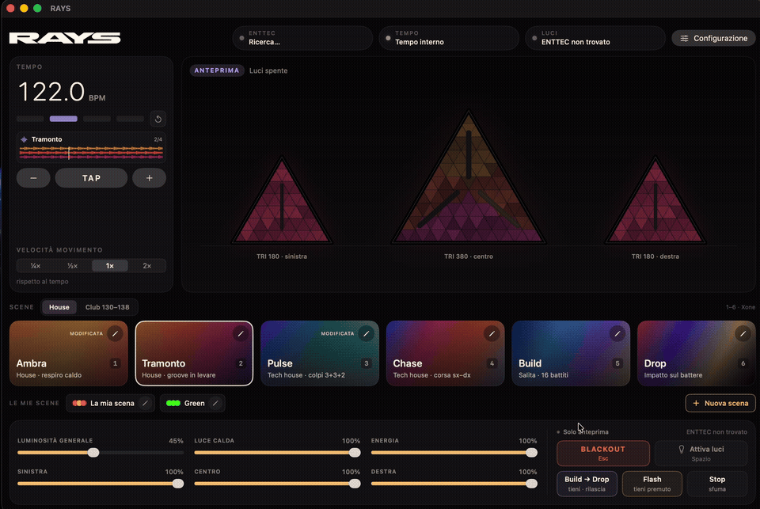

<p align="center">
  
</p>

<p align="center">
  <b>Beat-synced DMX lighting for DJs. Native on macOS, open to every light and controller.</b><br>
  Art-Net · Ableton Link · Pro DJ Link · MIDI controllers
</p>

<p align="center">
  <a href="LICENSE"></a>
  
  
  <a href="CONTRIBUTING.md"></a>
</p>

<!-- TODO: replace with a 10-second GIF of the stage preview reacting to a beat -->
<p align="center"></p>

RAYS turns a Mac into a lighting console that **follows the music by itself**. It locks to
the tempo of your DJ console or any Ableton Link app, and plays original choreographies on
real DMX fixtures through an Art-Net node. No lighting desk, no timeline programming, no
subscription.

> 🇮🇹 L'interfaccia è oggi in italiano. Manuale completo in italiano: [docs/manuale-it.md](docs/manuale-it.md).

## Why RAYS

- **Locks to the beat, not to a microphone.** Tempo and phase come from Ableton Link or straight
  from Pioneer CDJ/XDJ consoles over Pro DJ Link. Scenes land on the downbeat.
- **Choreographies, not chases.** Twelve built-in scenes in two banks (House, Club 130–138), plus
  your own, edited on a shared rhythm grid with per-track step, cycle, envelopes and timing.
- **Live preview that tells the truth.** The stage view decodes the very same DMX bytes that go
  out on the wire.
- **Hands on.** Full Allen & Heath Xone:K2 layout with LED feedback, MIDI Learn for anything else,
  Build → Drop gesture, Flash, Blackout.
- **Made for real gigs.** Auto-discovery of Art-Net nodes and consoles, automatic reconnection,
  safe blackout, no App Nap while lights are on.
- **Hackable.** A Foundation-only core (`LightCore`) with ~200 unit tests and fixtures described
  in plain JSON.

## Quick start

Requirements: macOS 14+, Xcode 16 / Swift 6, an Art-Net node (tested: ENTTEC ODE MK3).

```sh
git clone --recursive https://github.com/gasparoff/rays.git
cd rays
Scripts/bootstrap.sh     # fetches Ableton Link (submodule) and the Beat Link helper
swift test               # run the core test suite
Scripts/build-app.sh     # builds dist/RAYS.app
open dist/RAYS.app
```

No hardware yet? Launch the app anyway: the stage preview runs without any light connected.

## Supported hardware

| Type | Supported | Status |
|---|---|---|
| Art-Net nodes | ENTTEC ODE MK3 | ✅ tested on hardware |
| Art-Net nodes | Any Art-Net 4 node | 🟡 should work, [report it](../../issues/new?template=hardware-report.yml) |
| Fixtures | Varytec Retro Blinder TRI 180 (5/8 ch), TRI 380 (5/25 ch) | ✅ verified profiles |
| Fixtures | Generic RGB, RGBW, Dimmer+RGB, Dimmer+RGBW | ✅ built in |
| Controllers | Allen & Heath Xone:K2 (Classic and Live v2 layouts) | ✅ |
| Controllers | Any MIDI controller | ✅ via MIDI Learn |
| Tempo | Ableton Link, Pioneer Pro DJ Link (CDJ/XDJ) | ✅ |

**Your light is missing?** Adding it takes one JSON file and no Swift:
see [Add a fixture](docs/adding-a-fixture.md). Every new profile is a welcome first PR.

## How it works

```
 Pro DJ Link ─┐                                 ┌─► Stage preview (SwiftUI/AppKit)
 Ableton Link ┼─► Tempo ─► Scene sequencer ─► DMX composer ─┤
 MIDI (K2)  ──┘           (choreographies)    (patch+profiles) └─► Art-Net ─► node ─► lights
```

| Module | What lives there |
|---|---|
| `Sources/LightCore` | Foundation-only engine: Art-Net, discovery, patch, fixture profiles, scenes, sequencer, MIDI routing. Fully unit-tested. |
| `Sources/LightSystem` | The macOS app: SwiftUI views, editor, MIDI and network services. |
| `Sources/LinkBridge` | Thin C bridge over the official Ableton Link C++ SDK. |
| `Sources/BeatLinkHelper` | Headless Java adapter over Beat Link, run as a child process. |
| `Profiles/` | Community fixture profiles (JSON), bundled into the app. |

More in [docs/architecture.md](docs/architecture.md).

## Contributing

RAYS grows with the people who use it on stage. The easiest ways in:

1. **Add a fixture profile** for a light you own ([guide](docs/adding-a-fixture.md)).
2. **Add a controller layout** ([guide](docs/adding-a-controller.md)).
3. **Share a scene idea** in [Discussions](../../discussions).
4. **Translate the UI** (English first!).

Read [CONTRIBUTING.md](CONTRIBUTING.md) and look for
[`good first issue`](../../issues?q=is%3Aopen+label%3A%22good+first+issue%22).

## Safety

RAYS can drive strobes and high-power blinders. Built-in scenes never trigger fixtures'
internal strobe programs, and Esc always means blackout. Respect photosensitivity
guidelines when you design your own scenes.

## Author

RAYS is created and maintained by **Manuel Gasparini** ([@gasparoff](https://github.com/gasparoff)),
born from real club nights and tested on real rigs. If RAYS lights up your set, a ⭐ helps others find it.

## License

RAYS source code is [MIT](LICENSE). Built apps include Ableton Link (GPLv2+) and run
Beat Link (EPL-2.0) as a helper: see [THIRD_PARTY_NOTICES.md](THIRD_PARTY_NOTICES.md).
RAYS is not affiliated with Ableton, Pioneer DJ, ENTTEC, Varytec or Allen & Heath.
